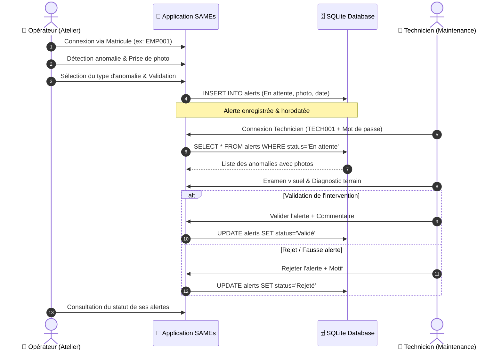

<a id="readme-top"></a>

<!-- PROJECT SHIELDS -->
<div align="center">

[](https://www.python.org/)
[](https://kivy.org/)
[](https://kivymd.readthedocs.io/)
[](https://www.sqlite.org/)
[](https://opencv.org/)
[](https://passlib.readthedocs.io/)
[](https://kivy.org/)

</div>

<br />

<!-- HEADER WITH ANIMATED TYPING SVG -->
<div align="center">
  <h1 align="center">📱 SAMEs : Solution d'Alerte de Maintenance par l'Employé</h1>

  <a href="https://github.com/imad-elades/SAMEs_app">
    
  </a>

  <p align="center">
    <strong>Application mobile multiplateforme permettant aux opérateurs de production de signaler instantanément les pannes et anomalies de machines avec capture photo et géolocalisation d'atelier.</strong>
    <br />
    Comble le fossé entre les opérateurs terrain et les équipes de maintenance pour réduire le MTTR (Mean Time To Repair) et éradiquer les pannes critiques avant l'arrêt de ligne.
    <br />
    <br />
    <a href="#-documentation--livrables"><strong>Consulter les Livrables »</strong></a>
    <br />
    <br />
    <a href="docs/Presentation_SAMEs_Solution.pptx">📊 Télécharger la Présentation (PPTX)</a>
    ·
    <a href="#-fonctionnalités-clés">✨ Fonctionnalités Clés</a>
    ·
    <a href="#-types-danomalies-gérées">⚠️ Types d'Anomalies</a>
    ·
    <a href="https://github.com/imad-elades/SAMEs_app/issues">🐛 Signaler un Problème</a>
  </p>
</div>

---

<!-- TABLE OF CONTENTS -->
<details open>
  <summary>📋 <strong>Table des Matières</strong></summary>
  <ol>
    <li><a href="#-contexte-industriel--problématique">Contexte Industriel & Problématique</a></li>
    <li><a href="#-documentation--livrables">Documentation & Livrables</a></li>
    <li><a href="#-fonctionnalités-clés">Fonctionnalités Clés</a></li>
    <li><a href="#-workflow-et-architecture">Workflow et Architecture</a></li>
    <li><a href="#-types-danomalies-gérées">Types d'Anomalies Gérées</a></li>
    <li><a href="#-gestion-des-rôles--sécurité">Gestion des Rôles & Sécurité</a></li>
    <li><a href="#-structure-du-projet">Structure du Projet</a></li>
    <li>
      <a href="#-démarrage-rapide">Démarrage Rapide</a>
      <ul>
        <li><a href="#prérequis">Prérequis</a></li>
        <li><a href="#installation">Installation</a></li>
        <li><a href="#comptes-de-test-fournis">Comptes de test fournis</a></li>
      </ul>
    </li>
    <li><a href="#-auteurs">Auteurs</a></li>
    <li><a href="#-licence">Licence</a></li>
  </ol>
</details>

---

## 🏭 Contexte Industriel & Problématique

> **Constat :** Selon les études industrielles (*Plant Engineering*), **plus de 37% des entreprises manufacturières n'intègrent pas les retours des opérateurs de première ligne** dans leurs processus de maintenance.

Dans les ateliers de production, un arrêt machine majeur est presque toujours précédé de signaux faibles (bruits inhabituels, vibrations anormales, micro-fuites, surchauffe). Sans un outil rapide et accessible, ces anomalies ne sont pas signalées à temps, conduisant à des arrêts non planifiés très coûteux.

**La solution S.A.M.E. (Système d'Alerte de Maintenance par l'Employé)** s'inscrit au cœur de la démarche **TPM (*Total Productive Maintenance*)** :
1. **Démocratiser le signalement :** Permettre à tout opérateur, en moins de 30 secondes, de photographier et catégoriser une anomalie dès son apparition.
2. **Réduire le temps de réaction :** Transmettre immédiatement l'alerte sur le tableau de bord des techniciens de maintenance avec statut et preuve visuelle.
3. **Historiser et tracer :** Conserver un historique complet des interventions et des anomalies récurrentes par machine.

<p align="right">(<a href="#readme-top">Retour en haut ⬆️</a>)</p>

---

## 📚 Documentation & Livrables

| Document / Ressource | Format | Description | Lien Direct |
|:---|:---:|:---|:---:|
| **Présentation de la Solution** | PPTX | Support de présentation complet (35 diapositives) : problématique TPM, ROI industriel, démonstration de l'interface mobile, et cas d'usage. | [📊 **Télécharger la Présentation**](docs/Presentation_SAMEs_Solution.pptx) |
| **Code Source Mobile** | Python / KV | Application complète (Frontend KivyMD réactif, backend SQLite, gestion caméra Plyer/OpenCV). | [📱 **Consulter main.py**](main.py) |
| **Schéma de Base de Données** | SQL / SQLite | Tables `users`, `alerts`, `anomaly_types` avec intégrité référentielle et hashage bcrypt. | [🗄️ **Voir init_db.py**](init_db.py) |

<p align="right">(<a href="#readme-top">Retour en haut ⬆️</a>)</p>

---

## ✨ Fonctionnalités Clés

* 📸 **Capture Photo Intégrée :** Prise de photo directe depuis l'appareil photo du smartphone ou de la tablette industrielle via Plyer et OpenCV.
* ⚡ **Signalement Ultra-Rapide (3 étapes) :** Connexion par matricule ➔ Prise de photo ➔ Choix du type d'anomalie ➔ Envoi instantané.
* 📋 **Tableau de Bord Technicien :** Vue unifiée de toutes les alertes de l'usine, triées par statut (*En attente 🟡, Validée 🟢, Rejetée 🔴*), avec horodatage, photo agrandissable et ajout de commentaires d'intervention.
* ⏱️ **Sécurité & Déconnexion Automatique :** Timeout de session après 2 minutes d'inactivité pour garantir la sécurité sur les terminaux partagés en atelier.
* 📱 **Multiplateforme Native :** Conçue avec Kivy et KivyMD pour fonctionner sous Android (déploiement APK), iOS, ou postes tactiles Windows/Linux.

<p align="right">(<a href="#readme-top">Retour en haut ⬆️</a>)</p>

---

## 🔄 Workflow et Architecture



<p align="right">(<a href="#readme-top">Retour en haut ⬆️</a>)</p>

---

## ⚠️ Types d'Anomalies Gérées

L'application catégorise les défauts selon 9 typologies industrielles standardisées :

| Type d'Anomalie | Description Technique | Risque Associé |
|:---|:---|:---|
| 🔊 **Bruit** | Sons métalliques, grincements, sifflements anormaux | Roulement défectueux, manque de lubrification |
| 📳 **Vibration** | Secousses, battements mécaniques excessifs | Balourd, désalignement d'arbre, desserrage |
| 🔥 **Chaleur** | Température de carter ou moteur anormalement élevée | Surcharge électrique, friction anormale |
| 💧 **Fuite** | Écoulement de fluide hydraulique, huile, eau ou gaz | Baisse de pression, risque de glissade |
| 👃 **Odeur** | Émanation de brûlé, plastique chaud, odeurs chimiques | Court-circuit imminent, échauffement courroie |
| ⚡ **Coupure** | Micro-coupure ou arrêt intempestif de cycle | Défaut capteur, problème d'alimentation |
| ⚙️ **Usure** | Érosion visible, jeu excessif, écaillage de courroie | Fin de vie composant, perte de précision |
| 📐 **Déformation** | Cintrage, fissure ou gauchissement d'une pièce | Fatigue mécanique, choc ou surcharge |
| ❓ **Autre** | Tout défaut non répertorié nécessitant diagnostic | Anomalie spécifique à documenter |

<p align="right">(<a href="#readme-top">Retour en haut ⬆️</a>)</p>

---

## 🛡️ Gestion des Rôles & Sécurité

### Profils Utilisateurs
1. **Rôle Employé / Opérateur :**
   * Authentification simplifiée par matricule pour un usage rapide avec gants de travail.
   * Accès restreint : création d'alerte, visualisation de l'état d'avancement de ses propres signalements.
2. **Rôle Technicien de Maintenance :**
   * Authentification sécurisée par matricule et mot de passe chiffré (**Bcrypt**).
   * Accès étendu : tableau de bord central, validation/rejet des interventions, ajout de rapports d'intervention.

### Mesures de Sécurité Appliquées
* 🔒 **Mots de passe hashés :** Aucun mot de passe en clair (algorithme de hachage robuste avec sel via `passlib[bcrypt]`).
* ⏳ **Anti-oubli (Inactivity Timeout) :** Déconnexion forcée après 2 minutes sans interaction pour éviter les usurpations sur les postes fixes d'atelier.
* 🚫 **Régulation des alertes :** Mécanisme prévenant les doublons et les alertes spam.

<p align="right">(<a href="#readme-top">Retour en haut ⬆️</a>)</p>

---

## 📁 Structure du Projet

```
SAMEs_app/
├── docs/                               # Documentation et livrables
│   └── Presentation_SAMEs_Solution.pptx # Support de présentation complet (35 diapositives)
├── assets/                             # Photos réelles des anomalies enregistrées
│   ├── alert_20250426_160405.jpg
│   └── ...
├── config.py                           # Thème visuel, codes couleurs et statuts d'alerte
├── main.py                             # Cœur de l'application mobile et gestionnaire d'écrans
├── sames.kv                            # Définition des interfaces utilisateur déclaratives (Kivy)
├── init_db.py                          # Script de création du schéma SQLite et des utilisateurs initiaux
├── sames.db                            # Base de données SQLite locale préconfigurée
├── requirements.txt                    # Dépendances Python du projet
└── .gitignore                          # Règles d'exclusion Git (exclut .venv/ et vidéos lourdes)
```

<p align="right">(<a href="#readme-top">Retour en haut ⬆️</a>)</p>

---

## 🚀 Démarrage Rapide

### Prérequis
* Python 3.11 ou supérieur installé.
* Gestionnaire de paquets `pip`.

### Installation

```bash
# 1. Cloner le dépôt
git clone https://github.com/imad-elades/SAMEs_app.git
cd SAMEs_app

# 2. Créer un environnement virtuel isolé (recommandé)
python -m venv .venv
.venv\Scripts\activate      # Sous Windows
source .venv/bin/activate    # Sous Linux/macOS

# 3. Installer les dépendances
pip install -r requirements.txt

# 4. Initialiser la base de données (si sames.db n'est pas déjà présent)
python init_db.py

# 5. Lancer l'application
python main.py
```

### 🔑 Comptes de test fournis par défaut

| Rôle | Matricule | Mot de passe | Permissions |
|:---|:---:|:---:|:---|
| **Opérateur 1** | `EMP001` | *(Aucun mot de passe requis)* | Signaler des anomalies & suivre ses alertes |
| **Opérateur 2** | `EMP002` | *(Aucun mot de passe requis)* | Signaler des anomalies & suivre ses alertes |
| **Technicien 1** | `TECH001` | `tech123` | Valider / Rejeter les alertes atelier |
| **Technicien 2** | `TECH002` | `tech456` | Valider / Rejeter les alertes atelier |

<p align="right">(<a href="#readme-top">Retour en haut ⬆️</a>)</p>

---

## 👨‍💻 Auteurs

Projet conçu et développé dans le cadre de l'optimisation des flux de maintenance industrielle :
* **Imad EL ADES (iM@Des)** — Ingénieur en Transformation Digitale Industrielle ([@imad-elades](https://github.com/imad-elades))
* **Salah ATMANE** — Co-concepteur

---

## 📄 Licence

Ce projet est distribué sous licence open-source MIT.

<p align="right">(<a href="#readme-top">Retour en haut ⬆️</a>)</p>
